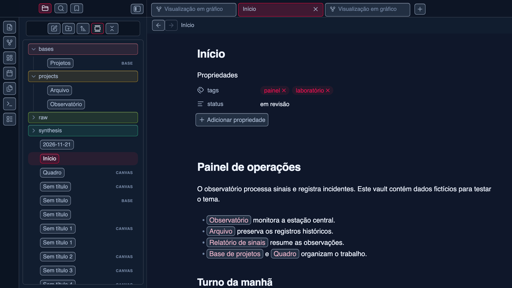

# Blue Jeans

A blue-toned theme for Obsidian by Rander Carrijo. It supports light and dark modes, follows your Obsidian accent color, and gives links, tabs, and sidebar controls visible borders.

## Install

Copy `manifest.json` and `theme.css` into `.obsidian/themes/Blue Jeans/` inside your vault. Select **Blue Jeans** in **Settings → Appearance → Themes**.

Blue Jeans requires Obsidian 1.15.1 or later. On desktop, use Obsidian installer 1.15.1 or later.

## Customize

Set your accent under **Settings → Appearance**. The optional Style Settings plugin adds controls for blur, opacity, corner radius, the default accent, and folder colors.

## License

Blue Jeans is available under the MIT license. [License](LICENSE)
